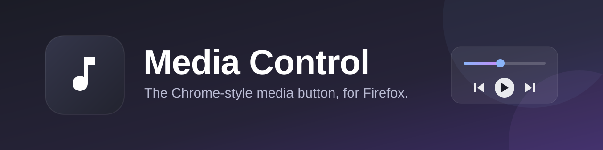
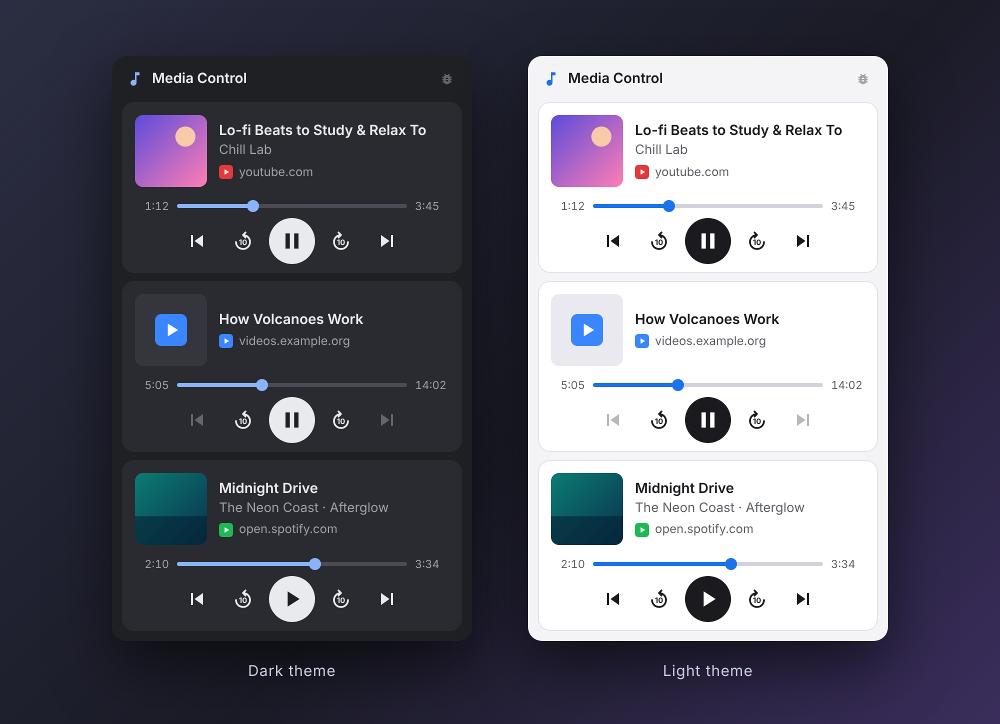

<p align="center">
  
</p>

<p align="center">
  <a href="https://www.mozilla.org/firefox/"></a>
  
  
  
  
</p>

<p align="center">
  <b>One button. Every tab that is playing sound or video. Full control.</b><br>
  The media panel that Chrome, Edge and Brave users already love, now in Firefox.
</p>

<p align="center">
  <a href="#-why-this-exists">Why</a> ·
  <a href="#-features">Features</a> ·
  <a href="#-install">Install</a> ·
  <a href="#-how-to-use-it">Usage</a> ·
  <a href="#-faq--troubleshooting">FAQ</a> ·
  <a href="#-privacy--permissions">Privacy</a> ·
  <a href="#-for-developers">Developers</a>
</p>

<p align="center">
  
</p>

<p align="center">
  <sub>The popup in Firefox's dark and light themes. Sample data.</sub>
</p>

---

## 🎯 Why this exists

If you use **Chrome**, **Edge** or **Brave**, you know the small music button in the toolbar. You click it and see every tab that is playing sound or video. You can pause, skip, or jump to that tab, all without hunting through twenty open tabs to find the one that is making noise.

**Firefox never had this.** It shows a speaker icon on the tab and supports your keyboard's media keys, but there is no panel where you can see and control all your media in one place.

**Media Control adds that missing feature to Firefox.** Install it, pin the button, and it works the way you remember from Chrome.

| | Chrome, Edge, Brave | Firefox | Firefox + **Media Control** |
|---|:---:|:---:|:---:|
| One toolbar button for all media | ✅ | ❌ | ✅ |
| See every tab that is playing | ✅ | ❌ | ✅ |
| Play / pause from one place | ✅ | ❌ | ✅ |
| Progress bar you can drag | ✅ | ❌ | ✅ |
| Skip back / forward | ✅ | ❌ | ✅ (10 seconds) |
| Previous / next track | ✅ | ❌ | ✅ (where the site supports it) |
| Thumbnail, title and artist | ✅ | ❌ | ✅ |
| Click a card to jump to its tab | ✅ | ❌ | ✅ |

## ✨ Features

- **Automatic.** Nothing to set up. Any tab that plays audio or video appears in the panel by itself.
- **All your tabs, all your windows.** One card per tab, across every Firefox window.
- **Full controls.** Previous · back 10 s · play / pause · forward 10 s · next, plus a progress bar you can drag.
- **Rich cards.** Thumbnail, title, artist and the site name, just like in Chrome.
- **Jump to the tab.** Click a card's title or thumbnail and Firefox takes you straight to it.
- **Paused media stays.** Pause a video and it stays in the list, so you can resume it later. It goes away when you close the tab.
- **Muted media is included.** Muted videos and audio with the volume at zero are listed too.
- **Light and dark themes.** The popup follows your Firefox theme. The toolbar icon adapts too: white on dark themes, black on light themes.
- **Works inside embedded players.** A video embedded in another page (for example a YouTube video on a news site) is found as well.
- **Spotify Web support.** Spotify's web player is handled specially, in any interface language, even with the volume at zero.
- **Quiet and private.** No background process, no account, no tracking. See [Privacy](#-privacy--permissions).
- **Tiny and dependency-free.** Plain HTML, CSS and JavaScript. No build step.

## 📦 Install

> **Requires Firefox 128 or newer.**

### Option A: Install permanently (recommended)

Firefox only keeps *signed* extensions after a restart.

1. Go to the [**Releases**](../../releases/latest) page and download the latest `media-control-*.xpi` file.
2. Open the file in Firefox (drag it into the window, or use **☰ → Add-ons and themes → ⚙ → Install Add-on From File…**).
3. Click **Add** when Firefox asks for permission.

> Don't see a `.xpi` in Releases? Then no signed build has been published yet. Use Option B, or [sign it yourself](#build-and-sign-it-yourself); it is free.

### Option B: Try it for now (temporary)

This lasts until you close Firefox. It is the fastest way to try the extension.

1. [Download this repository](../../archive/refs/heads/main.zip) and unzip it.
2. In Firefox, open `about:debugging#/runtime/this-firefox`.
3. Click **Load Temporary Add-on…** and choose the `manifest.json` file from the folder.

### After installing

1. **Pin the button.** Click the 🧩 puzzle-piece icon in the toolbar, then the 📌 pin next to **Media Control**.
2. **Reload tabs that were already open.** An extension can only watch pages that were loaded after it was installed.
3. *(Optional)* **Private windows:** open `about:addons` → **Media Control** → **Run in Private Windows** → **Allow**.

## 🚀 How to use it

1. Play something: a song, a video, a podcast, in any tab.
2. Click the **♪ Media Control** button in the toolbar.
3. Use the controls on the card:

| Control | What it does |
|---|---|
| **⏮ Previous** / **⏭ Next** | Previous / next track (available when the site supports it, otherwise greyed out) |
| **⟲10** / **10⟳** | Go back / forward 10 seconds |
| **⏸ / ▶** | Pause or resume |
| **Progress bar** | Click or drag to jump to any point |
| **Title or thumbnail** | Switch to that tab |

Click anywhere else in the browser and the popup closes by itself. The extension has no background process: it only asks your tabs what is playing while the popup is open.

## 🌐 Works with

| Site | Status |
|---|---|
| **YouTube** | ✅ Title, artwork, seeking, previous / next in playlists |
| **Spotify Web** | ✅ Special support: works in any language, and when muted or at zero volume |
| **Other sites** with a standard HTML5 `<video>` or `<audio>` player | ✅ Expected to work, with extra features (artwork, track buttons) on sites that provide them |
| Camera and video-call streams | ➖ Ignored on purpose |
| Sound produced only through the Web Audio API (some games, web synths) | ➖ Not controllable, because there is no media element to control |

Found a site that doesn't work? Please [open an issue](../../issues) (see [Reporting a problem](#reporting-a-problem)).

## ❓ FAQ / Troubleshooting

<details>
<summary><b>Nothing shows up in the popup</b></summary>

1. **Reload the tab.** Tabs opened before you installed the extension aren't watched until they are reloaded.
2. Make sure something has actually **started playing**. A page that has never played anything is not listed.
3. Open `about:addons` → **Media Control** → **Permissions** and check that access to websites is turned on.
4. Private window? Allow the extension there (see [After installing](#after-installing)).
</details>

<details>
<summary><b>The card says "Reload this tab to finish updating"</b></summary>

You updated the extension while that tab was open. Reload the tab and the message goes away.
</details>

<details>
<summary><b>The previous / next buttons are greyed out</b></summary>

The website doesn't offer track skipping for what is playing (a single video, for example). The ⟲10 / 10⟳ buttons always work.
</details>

<details>
<summary><b>I can't find the button in the toolbar</b></summary>

Firefox may hide new extensions in the 🧩 puzzle-piece menu. Click it and pin **Media Control**.
</details>

<details>
<summary><b>Why do I see videos that I'm not really watching?</b></summary>

Muted media is listed on purpose. That can include things like the silent preview that plays when you hover a video on a home page. Pause it, or ignore it; it disappears when the page removes it or the tab closes.
</details>

<details>
<summary><b>Why does the card disappear when I open another page in the same tab?</b></summary>

Navigating to a new page replaces the old one, and the old media is gone with it. Anything you play on the new page shows up again.
</details>

### Reporting a problem

Click the small **bug icon** in the top-right corner of the popup while you are on the problematic tab. It copies a technical report to your clipboard. Paste it into your [GitHub issue](../../issues).

> ⚠️ The report contains the **address of the tab** and the **title of the track**. Read it before posting, and remove anything you don't want to share.

## 🔒 Privacy & permissions

Media Control is built to stay out of your way.

- **No data is collected, stored or sent anywhere.** The extension declares `none` for data collection.
- **No accounts, no analytics, no ads, no remote code.**
- It makes **no network requests of its own**. The only thing the popup loads from the internet is the **cover art** that the websites you are listening to provide.
- Your tabs only hand over their media information to the popup **when you open it**, and it never leaves your computer.

| Permission | Why it is needed |
|---|---|
| Access to all websites (`<all_urls>`) | To see which tabs have audio or video, and to control playback in them |
| `tabs` | To show each tab's title and icon, and to switch to a tab when you click its card |
| `webNavigation` | To find media inside embedded frames (for example an embedded video player) |
| `clipboardWrite` | Only for the bug icon, which copies the troubleshooting report |

## 🛠 For developers

### How it works

```mermaid
flowchart LR
    A["Web page<br/>video / audio + Media Session"] --> B["main-world.js<br/>runs inside the page"]
    B <--> C["bridge.js<br/>content script"]
    C <--> D["Popup<br/>popup.js"]
```

- **`content/main-world.js`** runs in the page's own context (`"world": "MAIN"`, which is why Firefox 128+ is needed). From there it can see media elements, including ones that are never attached to the page, and it records the [Media Session](https://developer.mozilla.org/docs/Web/API/Media_Session_API) metadata and action handlers that the site registers. It uses the site's own controls when they exist, so the site's player stays in sync.
- **`content/bridge.js`** is a small relay. It passes messages between the page-level script and the extension.
- **`popup/`** asks every tab (and every frame in it) for its state when opened, draws one card per tab, and sends commands back.
- **Spotify Web** is a special case: its player doesn't expose standard controls, so on `open.spotify.com` the extension reads the player bar on the page and clicks its real buttons.
- There is **no background script**. Pages keep track of their own media locally, and nothing is sent anywhere until you open the popup.

### Project structure

```
media-control/
├── manifest.json            Manifest V3
├── content/
│   ├── main-world.js        runs inside the page: finds media, reads metadata, controls playback
│   └── bridge.js            relays messages between the page and the extension
├── popup/
│   ├── popup.html
│   ├── popup.css            light + dark themes
│   └── popup.js             lists tabs, draws cards, sends commands
├── icons/                   toolbar icons (white and dark) and the add-on icon
└── docs/                    README images
```

### Run it while developing

```bash
npm install --global web-ext

web-ext run          # opens Firefox with the extension loaded and reloads it when you change files
web-ext lint         # checks the extension against Mozilla's rules
```

Or use `about:debugging` → **Load Temporary Add-on…** and click **Reload** after each change.

### Build and sign it yourself

Signing is free and does not require publishing the extension publicly.

1. Create a free account at [addons.mozilla.org/developers](https://addons.mozilla.org/developers/).
2. Build the package:
   ```bash
   web-ext build
   ```
3. Choose **Submit a New Add-on → On your own** (*unlisted*) and upload the `.zip` from `web-ext-artifacts/`.
4. Download the signed `.xpi` and install it from `about:addons` → ⚙ → **Install Add-on From File…**

Raise the `"version"` in `manifest.json` (and the matching `BUILD` value at the top of `content/main-world.js`) before each new upload.

## 💡 Ideas for the future

Nothing here is promised. These are just ideas:

- Choose how long the skip buttons jump (5 / 10 / 30 seconds)
- Volume and mute buttons on each card
- Keyboard shortcuts for play / pause and next / previous
- A list of sites to ignore
- A settings page

Have another idea? [Open an issue](../../issues) and say what you'd like.

## 🤝 Contributing

Contributions are welcome. The project has **no build step and no dependencies** on purpose, so please keep it that way: plain JavaScript that runs directly in Firefox.

1. Fork the repository and make your change.
2. Run `web-ext lint` and try the extension in Firefox.
3. Open a pull request that explains what changed and why.

## 📄 License

[MIT](LICENSE) © Media Control contributors

---

<p align="center">
  Made because Firefox deserves a proper media button. 🎵<br>
  If it saves you from hunting for the noisy tab, a ⭐ on the repo is much appreciated.
</p>
